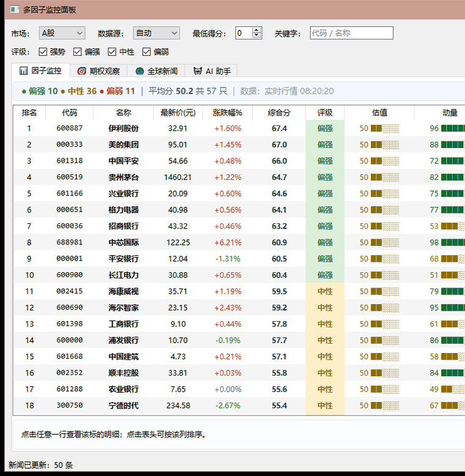
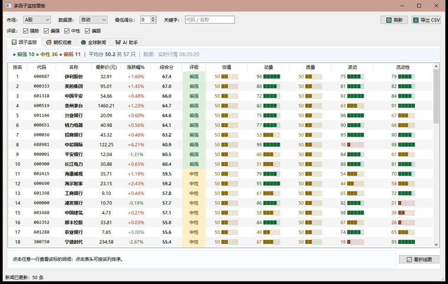
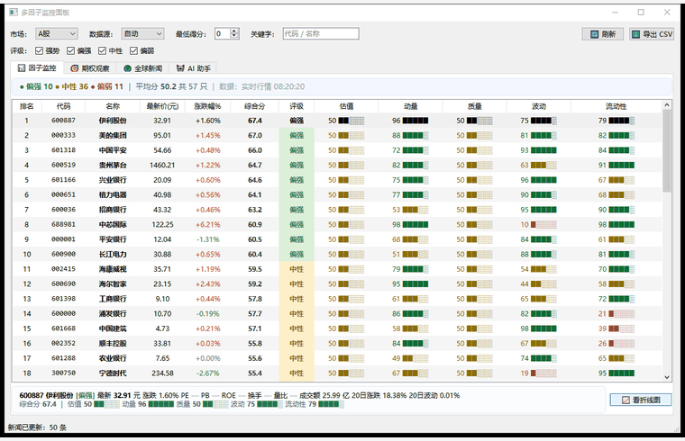
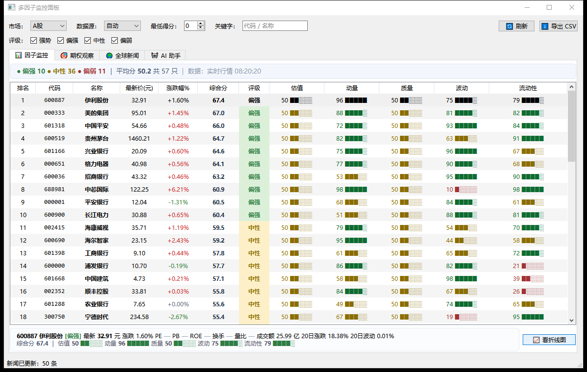
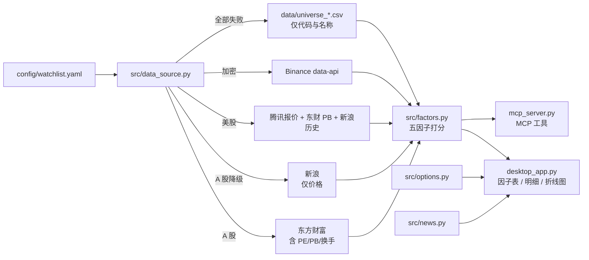

# 📊 多因子监控面板（Multi-Factor Monitor Panel）

一个**原生 Windows 桌面窗口**（PySide6，非浏览器）的行情与因子看板：A 股 / 美股 / 加密货币三市场横截面打分排名，真实期权链与 Black-Scholes 对照，全球财经快讯聚合，DeepSeek AI 解读，并可作为 **MCP 服务端**接入 DeepSeek Harness 等 Agent 框架。


[](https://github.com/chenzqy/multi-factor-panel/actions/workflows/ci.yml)
[](https://github.com/chenzqy/multi-factor-panel/releases)

> **直接下载**：[MultiFactorPanel.exe](https://github.com/chenzqy/multi-factor-panel/releases/latest/download/MultiFactorPanel.exe)（单文件免安装，约 87 MB）· [zip 打包版](https://github.com/chenzqy/multi-factor-panel/releases/latest/download/MultiFactorPanel-windows-x64.zip)

> 本项目仅为工具与教学演示，所有数据、因子得分与理论定价均不构成任何投资建议。

---

## ✨ 功能一览

| 模块 | 能力 |
| --- | --- |
| **因子监控** | 估值 / 动量 / 质量 / 波动 / 流动性五因子横截面百分位打分，加权综合分与评级，支持筛选、排序、CSV 导出 |
| **多市场** | A 股（东财 → 新浪 → 代码表三级降级）、美股（腾讯报价 + 东财 PB + 新浪历史）、加密货币（Binance 公开数据） |
| **外币折人民币** | 美股 / 加密市场价格旁自动给出「折人民币(¥)」列，汇率取新浪在岸即期，表头标注原币种 |
| **个股折线图** | 双击任意股票弹出独立窗口：当日 5 / 15 分钟分时、近 120 日日线，60 秒自动刷新，支持跟随主表选中切换 |
| **期权观察** | 中金所股指期权（IO / HO / MO）与上交所 ETF 期权（510050/510300/510500/588000）**真实期权链**：隐含波动率、Delta、持仓量、平价偏离，并可切换 BS 理论对照 |
| **全球新闻** | 东方财富 + 财联社快讯，可扩展 RSS；后台线程加载，设置项（来源 / 条数 / 自动刷新间隔）自动持久化 |
| **AI 助手** | 填入 DeepSeek API Key，自动带当前打分表与新闻作为上下文解读、追问 |
| **MCP 服务端** | `mcp_server.py` 暴露打分表 / 个股明细 / 新闻 / 自选 / 期权链工具，供外部 Agent 调用 |

---

## 📸 界面预览

**因子监控** —— 五因子横截面打分，条形图直接看出强项弱项：



**真实期权链** —— 切到期权页、一键拉链，IV 与 Delta 由市场价反解：



**个股折线图** —— 双击任意行弹出的独立窗口，当日分时 / 日线切换：



<details>
<summary>展开静态大图（因子表 / 期权链 / 折线图）</summary>

| 因子监控（真实行情 + 五因子得分条形） | 真实期权链（IO / ETF，含 IV 与 Delta） |
| --- | --- |
|  |  |



</details>

---

## 🚀 快速开始（Windows）

### 方式 A：双击启动（推荐，不需要打包）

1. 安装 **Python 3.10+**（勾选 *Add Python to PATH*）：<https://www.python.org/downloads/>
2. 双击 **`run_windows.bat`**
   - 首次运行自动安装依赖（需联网）；
   - 之后直接弹出桌面窗口，**不会闪出 CMD 黑框**（`launcher.pyw` + `pythonw.exe` 启动）；
   - 启动日志写到 `logs/launcher.log`。

### 方式 B：打包成独立 exe

双击 **`build_windows.bat`**，自动安装 PyInstaller 并打包，产物在 `dist\MultiFactorPanel.exe`，可单独复制到其他 Windows 电脑运行。

> 打包不能跨平台：Linux / macOS 上无法直接产出 Windows exe。

### 方式 C：命令行

```bat
python -m pip install -r requirements.txt
python desktop_app.py
```

### 方式 D：不装 GUI，20 秒验证它真能跑

只要装了 Python 和 `pandas / numpy / pyyaml`，就能在终端里跑通整条数据链路（拉行情 → 打分 → 排名），不需要 PySide6、不需要开窗口：

```bat
python -m pip install -r requirements-desktop.txt
python -m src.cli
python -m src.cli --market 美股 --top 3
python -m src.cli --source codes      # 完全不联网，只验证离线代码表与打分逻辑
```

典型输出：

```text
市场：A股　数据来源：auto
股票池：A 股 57 只 / 美股 65 只 / 加密 1 个
------------------------------------------------------------------------
耗时 9.4s　标的 57 只　数据档位：live
　缺数：PE 缺 57/57，PB 缺 57/57，ROE 缺 57/57
------------------------------------------------------------------------
排名  代码      名称               最新价     涨跌幅%     综合分    评级
1   600887  伊利股份           32.91     1.60    67.4    偏强
2   000333  美的集团           95.01     1.45    67.0    偏强
3   601318  中国平安           54.66     0.48    66.0    偏强
```

> 「数据档位：live / codes」直接告诉你现在用的是实时行情还是离线代码表；「缺数」一行列出这一档数据源缺了哪些字段——这就是本项目的核心哲学：**宁可显示「—」，也不假装有数据。**

---

## 🧪 开发与测试

```bat
python -m pip install -r requirements-dev.txt
python -m pytest -q
```

测试不依赖 PySide6 / akshare / 网络，只覆盖纯逻辑与仓库卫生：

| 测试文件 | 覆盖内容 |
| --- | --- |
| `tests/test_factors.py` | 因子打分：排名连续性、亏损股 PE≤0 判最差、**PE 缺失不算亏损**、单标的退化为中性 50、权重归一化、`attrs` 透传 |
| `tests/test_repo_smoke.py` | 全仓 `compileall`、`watchlist.yaml` 可解析且 `api_key` 为空、离线代码表存在、无本机绝对路径 |

> 单标的那条测试对应一个真实 bug：加密市场只有 BTC 一个标的时，`rank(pct=True)` 恒等于 1.0，会让"越低越好"的波动因子恒得 0 分。

### 持续集成

`.github/workflows/ci.yml` 在 Ubuntu 与 Windows 上跑 Python 3.10 / 3.12 矩阵：

1. `compileall` 语法检查；
2. `pytest` 单元测试；
3. 编码与卫生检查——所有文本文件必须是合法 UTF-8，禁止出现疑似 API Key、本机路径、`config/ui_state.json`。

### 自动发布

`.github/workflows/release.yml` 支持两种触发：

```bat
git tag v1.0.0
git push origin v1.0.0
```

或在 Actions 页面手动 `Run workflow` 并填版本号。CI 会在 `windows-latest` 上用 `MultiFactorPanel.spec` 打包成单文件 exe，
连同 `SHA256` 一起发布到 Releases（`MultiFactorPanel.exe` + `MultiFactorPanel-windows-x64.zip`）。

---

## 🗂 项目结构

```
multi_factor_panel/
├── desktop_app.py            # ★ 桌面程序主入口（PySide6 窗口、因子表、期权页、新闻页、AI 页、折线图窗口）
├── mcp_server.py             # ★ MCP 服务端（stdio），把看板数据暴露给外部 Agent
├── launcher.pyw              # 无控制台启动器（pythonw 启动，异常写日志并弹窗）
├── run_windows.bat           # 双击启动
├── build_windows.bat         # 一键打包 exe
├── requirements.txt          # 完整依赖
├── requirements-desktop.txt  # 桌面版最小依赖（bat 脚本使用）
├── requirements-dev.txt      # 跑单元测试所需（无 GUI 依赖）
├── MultiFactorPanel.spec     # PyInstaller 配置
├── tests/                    # 单元测试（因子打分 / 语法 / 配置卫生）
├── docs/
│   ├── ARCHITECTURE.md       # 分层结构、降级链、关键设计取舍
│   ├── DATA-SOURCES.md       # ★ 数据源口径与限流应对（复刻必读）
│   ├── DATA-SOURCE-FALLBACK.md  # ★ 行情接口挂了怎么办（按症状排查）
│   └── screenshots/          # 界面截图与演示 GIF
├── config/
│   └── watchlist.yaml        # 股票池、权重、新闻源、DeepSeek、期权品种等全部配置
├── data/
│   ├── universe_a.csv        # A 股全市场代码表（5000+ 只真实代码与名称）
│   └── universe_us.csv       # 美股代码表（65 只，含中概）
├── dsh/
│   └── monitor-panel.cordis.yml  # dsh MCP client 配置示例
└── src/
    ├── data_source.py        # 三市场行情接入与降级策略
    ├── factors.py            # 因子计算与横截面打分
    ├── screener.py           # 条件筛选与 CSV 导出
    ├── options.py            # 真实期权链、IV 反解、BS 定价与希腊字母
    ├── crypto.py             # 加密货币行情与人民币汇率
    ├── chartdata.py          # 个股分钟线 / 日线数据
    ├── news.py               # 新闻聚合
    ├── ai_assistant.py       # DeepSeek 对话接入
    ├── uistate.py            # 界面设置持久化
    └── paths.py              # 资源路径解析（兼容 PyInstaller）
```

## 🔄 数据流



---

## 🆚 为什么不直接调 akshare

很多人的第一反应是「我自己写 30 行 akshare 就能出这张表」。可以，但下面这些坑每一条都要重新踩一遍：

| 场景 | 直接调 akshare / 公开接口 | 本项目 |
| --- | --- | --- |
| **期权链** | 拉到的只是合约代码与报价，想得到 IV / Delta 得自己反解；股指期权的标的还是**股指期货**，用沪深 300 现货去算会得到「Call 13% vs Put 25.7%」的假微笑 | 先用看跌-看涨平价 `F = K + (C − P)·e^{rT}` 反解隐含远期，再反解 IV；Call/Put 两侧波动率对齐 |
| **字段口径** | 每个接口字段含义不同，东财 `ulist` 里 `f23` 才是 PB×100、`f167` 是别的东西；腾讯报价 `[39]` 是 PE、`[46]` 是 EPS | 全部整理成 12 列统一 schema：`code/name/price/change_pct/pe/pb/roe/momentum_20d/volatility_20d/turnover/amount/volume_ratio` |
| **限流** | 东财 `push2` 一限流就是 `Push2RateLimitError`，并发 130 直接 502，恢复窗口从 5 分钟累加到 40 分钟 | 三级降级链（东财 → 新浪 → 代码表），并发压到 6~8，界面上明确标出当前数据档位 |
| **数据源失效** | akshare 频繁改名：`stock_zh_a_hist` → `stock_zh_a_hist_em`、`option_current_em` → `option_realtime_em`，升级就 AttributeError | 已改用新名，并把每个接口的**失效表现**写进 [docs/DATA-SOURCES.md](docs/DATA-SOURCES.md) 和 [docs/DATA-SOURCE-FALLBACK.md](docs/DATA-SOURCE-FALLBACK.md) |
| **跨市场** | A 股 / 美股 / 加密三套完全不同的接口、字段、货币，写三遍横截面打分逻辑 | 三市场同构：统一 schema 后跑同一套五因子打分，美股与加密自动折人民币显示 |
| **缺数处理** | `NaN` 参与排序会静默变成最小值，亏损股（PE ≤ 0）反而拿最高估值得分 | 缺失按中性 50 分；PE ≤ 0 明确钉到最差；单标的时不做百分位（恒等陷阱），直接给中性 |
| **接入 Agent** | 要自己写 MCP server、定义工具 schema、处理 stdio 生命周期 | `mcp_server.py` 已暴露 6 个只读工具，dsh 里一行配置接进来 |
| **分时图** | 拿到的 K 线跨夜会连成假斜线，午休 11:30–13:00 会留出空档 | 按最后交易日过滤 + 等距序号分类轴，两点都处理掉了 |

一句话总结：**这不是「又一个 akshare 封装」，而是把「免费行情源的脾气」沉淀成代码和文档。**

---

## ⚙️ 配置：`config/watchlist.yaml`

```yaml
stocks:                       # A 股自选（6 位代码）
  - {code: "600519", name: "贵州茅台"}
us_stocks:                    # 美股自选
  - {code: "AAPL", name: "苹果"}
crypto: ["BTC"]               # 加密货币（Binance 交易对前缀）
options_a: {symbol: 华泰柏瑞沪深300ETF期权, end_month: ""}
options_us: {symbol: AAPL}

news:
  limit: 50
  sources: ["eastmoney", "cls"]
  auto_refresh_minutes: 0     # 0 = 仅手动刷新
  rss_feeds: []               # 可选境外 RSS：[{name, url}]

deepseek:
  api_key: ""                 # 留空则在界面里临时输入
  base_url: https://api.deepseek.com
  model: deepseek-flash

weights:                      # 权重无需相加为 1，程序自动归一化
  valuation: 0.25
  momentum: 0.20
  quality: 0.25
  volatility: 0.15
  liquidity: 0.15

settings:
  momentum_window: 20
  top_n: 10
  data_source: auto           # auto / live / codes
  pool_size: 57
```

### 因子口径

| 因子 | 含义 | 方向 |
| --- | --- | --- |
| valuation 估值 | PE、PB 越低越便宜 | 越低越好 |
| momentum 动量 | 近 20 日涨跌幅 | 越高越好 |
| quality 质量 | ROE 净资产收益率 | 越高越好 |
| volatility 波动 | 近 20 日收益率标准差 | 越低越稳健 |
| liquidity 流动性 | 成交额活跃度 | 越高越好 |

评级：`≥80 强势` / `60~80 偏强` / `40~60 中性` / `<40 偏弱`。缺失指标按中性 50 分处理，界面显示 `—`。

---

## 🌐 数据来源

| 数据 | 主源 | 降级 / 备注 |
| --- | --- | --- |
| A 股快照 | 东方财富 `stock_zh_a_spot_em`（价格、PE、PB、换手、量比） | 新浪 `stock_zh_a_spot_sina`（仅价格）；再降级为代码表 |
| A 股日线 | `stock_zh_a_hist_em` | akshare ≥ 1.20.46 已改名，旧名会抛 `AttributeError` |
| 美股报价 | 腾讯 `qt.gtimg.cn`（价格、涨跌幅、成交额、PE） | 代码需把 `BRK-B` 写成 `BRK.B` |
| 美股 PB | 东方财富 ulist 批量（`f23` 才是市净率×100） | 逐只 `push2` 兜底 |
| 美股动量 / 波动 | 新浪 `US_MinKService.getDailyK` 全历史日线 | yfinance（常 429） |
| 加密货币 | `data-api.binance.vision`（唯一可直连的 Binance 域） | 其余交易所域名在部分网络下不可达 |
| 人民币汇率 | 新浪 `fx_susdcny`（在岸即期，GBK + Referer） | — |
| 期权链 | 新浪：中金所 `option_cffex_*`、上交所 ETF `option_sse_*` | 东财期权接口常限流 |
| 个股 K 线 | 新浪 `CN_MarketDataService.getKLineData` | 美股分时无公开可用源，只提供日线 |
| 新闻 | 东方财富、财联社 | RSS 可扩展 |

### 期权定价的两个关键点

1. **股指期权的标的是股指期货**，不是沪深 300 现货。程序先用看跌-看涨平价 `F = K + (C − P)·e^{rT}` 反解隐含远期，再以 `S = F`、`q = r` 反解隐含波动率；否则会得到「Call 13% vs Put 25.7%」的假微笑。
2. ETF 期权到期日为**第四个周三**，中金所股指期权为**第三个周五**。

> 每个接口的字段含义、限流表现、失效通道与降级策略，全部整理在 **[docs/DATA-SOURCES.md](docs/DATA-SOURCES.md)**。想复刻或换数据源，先读这份文档能省掉大量试错。
>
> **某一列突然变成「—」？** 先看 **[docs/DATA-SOURCE-FALLBACK.md](docs/DATA-SOURCE-FALLBACK.md)** —— 按「症状 → 原因 → 处理」排查，覆盖东财限流、新浪降级、akshare 改名、期权链空白、美股代码格式、加密域名不可达、折线图假斜线七类高频故障。

---

## 🤖 接入 DeepSeek Harness（dsh）

`mcp_server.py` 以 stdio 方式暴露只读工具，模型侧工具名为 `mcp__monitor__<name>`：

| 工具 | 作用 |
| --- | --- |
| `list_stock_scores` | 多因子打分排名表（可选 `market`：A股 / 美股 / 加密货币） |
| `get_stock_detail` | 单只个股明细（`code` + `market`） |
| `list_latest_news` | 最新财经快讯 |
| `list_watchlist` | 自选清单 |
| `list_option_markets` | 可用期权品种与到期月 |
| `list_option_chain` | 真实期权链（`market`、`expiry`、`max_rows`） |

接入步骤：

1. `python -m pip install -r requirements.txt`（需 `mcp<2.0`，2.x 已把 `FastMCP` 改名，代码不兼容）
2. 编辑 `dsh/monitor-panel.cordis.yml`，把 `args` 换成你本机 `mcp_server.py` 的绝对路径，`command` 填 `python`（找不到就填 `py`）
3. 临时生效：`dsh web --patch "<该文件的绝对路径>"`；长期生效：把 `- insert:` 整段合并进 `$DSH_HOME/profiles/<profile>/cordis.patch.yml`
4. 在 dsh 会话里提问，例如「看看打分最高的几只」「查一下 600519 的因子明细」

---

## ❓ 常见问题

**Q：切到「实时行情」后价格有，但 PE/PB/ROE/动量是「—」？**
A：主源东方财富被临时限流时会自动切新浪（只含价格），估值类因子留空。等东财恢复后点「刷新」自动补齐。

**Q：美股价格显示为「—」？**
A：确认代码拼写（`BRK-B` → `BRK.B`）。腾讯批量报价失败时会回落代码表，此时只有代码与名称。

**Q：ROE 为什么经常为空？**
A：免费快照不含 ROE，质量因子按中性 50 分处理。可在 `src/data_source.py` 补充财务报表接口。

**Q：提示「未检测到 Python」？**
A：安装 Python 3.10+ 并勾选 *Add Python to PATH*，或改用 `py -3`。

**Q：依赖装得很慢？**
```bat
python -m pip install -r requirements.txt -i https://pypi.tuna.tsinghua.edu.cn/simple
```

**Q：DeepSeek Key 会被上传吗？**
A：不会。Key 只存在本地（界面输入或 `watchlist.yaml`），请勿把填了 Key 的配置提交到仓库。

**Q：想新增因子？**
A：在 `src/factors.py` 的 `FACTOR_DIRECTION` / `FACTOR_LABELS` 注册，在 `_build_raw_factors()` 给原始值，再到 `watchlist.yaml` 加权重。

---

## 🧱 已知限制

- 仅针对 Windows 做了验证（`run_windows.bat` / `.pyw` 启动器 / PyInstaller 配置）；Linux、macOS 需自行改启动方式。
- 免费行情接口随时可能限流或改名（akshare 尤其频繁），代码里已做多级降级，但仍可能出现短时缺数。
- 美股分时线无可用公开数据源，只有日线。
- 期权链来自新浪公开接口，深度虚值合约 IV 可能为空（价格过小，反解不收敛）。
- 不包含任何交易、下单功能。

---

## 🤝 参与贡献

见 [CONTRIBUTING.md](CONTRIBUTING.md)。欢迎提 Issue、补充数据源适配、改进界面。

## 📄 许可证

[MIT](LICENSE) © 2026 YG

## ⚠️ 免责声明

本项目仅供学习与技术研究。行情数据来自第三方公开接口，可能存在延迟、缺失或错误；因子得分与期权理论价均为数学计算结果，**不构成任何投资建议**。据此操作风险自负。
