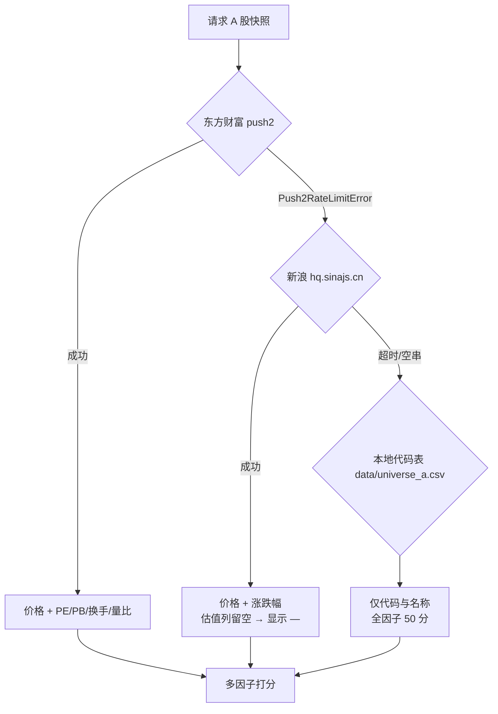

# 行情接口挂了怎么办

> 这份文档只回答一个问题：**面板某一列突然变成「—」，该去哪查、怎么恢复、哪些是真挂了哪些是被限流。**
> 完整的接口字段口径见 [DATA-SOURCES.md](DATA-SOURCES.md)；这里是从「现象」反推到「原因」的排查手册。

---

## 1. 先看三个地方，30 秒定位

| 看哪里 | 含义 | 怎么读 |
| --- | --- | --- |
| 概览条右侧「数据：…」 | 当前这一屏的数据来自哪一档 | `实时行情` = 东财主源；`新浪行情` = 已降级；`仅代码表` = 全部行情源失败 |
| 表里的「—」 | 该字段这一档数据源本来就不提供 | 新浪降级时 PE/PB/ROE 恒为「—」，不是 bug |
| 底部状态栏 | 刷新时间与新闻条数 | 刷新时间不前进 = 后台线程卡住或异常被吞 |

```text
数据：实时行情  ← 东财 OK，五因子全有值
数据：新浪行情  ← 东财限流中，只有价格/涨跌幅，估值类显示 —
数据：仅代码表  ← 全部行情源失败，只有代码与名称，全 50 分
```

---

## 2. 症状 → 原因 → 处理

### 2.1 价格有、PE/PB/ROE 全是「—」

**原因**：主源东方财富 `push2.eastmoney.com` 对高频请求限流，程序自动切到新浪 `hq.sinajs.cn`；新浪快照只有价格与涨跌幅，没有估值字段。

**判断依据**：概览条显示「新浪行情」；日志里出现 `Push2RateLimitError`。

**处理**：等 5–40 分钟（东财限流窗口实测 5 分钟起步，反复刷会累加到 40 分钟），再点「刷新」。不要去改代码——这是对方的服务端策略。

**别做的事**：不要为了提高刷新频率去并发拉东财。实测 130 并发会直接把接口打到 `502 Bad Gateway`，恢复时间反而更长。

### 2.2 全部显示「仅代码表」，分数全是 50

**原因**：三级降级链全部走到最后一档。常见组合是东财限流 + 新浪响应超时（弱网下 `hq.sinajs.cn` 会从 0.3 秒慢到 8 秒以上）。

**判断依据**：

```python
import requests
requests.get("https://push2.eastmoney.com/api/qt/clist/get", timeout=5)   # 限流会返回 502
requests.get("https://hq.sinajs.cn/list=sh600519",
             headers={"Referer": "https://finance.sina.com.cn"}, timeout=5)  # 慢 = 网络问题
```

**处理**：先确认本机出网正常（这条命令能不能返回内容），再确认目标站是否在维护。两者都正常就只是限流，等一会儿。

### 2.3 提示 `AttributeError: module 'akshare' has no attribute 'stock_zh_a_hist'`

**原因**：akshare 在 1.20.46 把函数改名为 `stock_zh_a_hist_em`（`option_current_em` → `option_realtime_em` 同理）。旧代码调用旧名会直接抛错。

**处理**：

```bash
python -m pip install -U akshare
# 或者把代码里的旧名换成新名
```

本项目已经用新名，遇到这个报错说明**你装的是很旧的 akshare**，或者你 fork 后Merge 了旧代码。

### 2.4 期权页报「拉取真实期权链失败」/ 整张表空白

**排查顺序**：

1. **先看是不是非交易时段**：期权链只在交易时段有价差，收盘后新浪返回上一交易日的静态值，深度虚值合约的 IV 会大面积为空（反解不收敛），这是正常的。
2. **合约代码是否过期**：`io2612` 这类合约到期后接口直接返回空。切到「到期」下拉框里选一个还有剩余天数的。
3. **东财期权接口改名**：旧代码里的 `option_current_em` 在 akshare 1.20.44 后叫 `option_realtime_em`。
4. **上交所 ETF 期权是逐合约拉取**，网络差时会长时间转圈——本项目用 8 线程并发 + 20 秒缓存，如果还是很慢，说明是对方接口慢，不是本地问题。

### 2.5 美股价格显示「—」

**原因**：腾讯批量报价接口按逗号拼接代码，代码格式错一只就整批失败。

**常见错误**：`BRK-B` 必须写成 `BRK.B`（配置里保留 `BRK-B`，代码里做转换）。

**验证**：

```bash
curl "https://qt.gtimg.cn/q=usAAPL,usBRK.B"
```

返回里没有 `usBRK.B` 那段，就是这个代码的问题。

### 2.6 加密货币全空

**原因**：中国大陆网络下，Binance 只有 `data-api.binance.vision` 这个公开数据域名能直连；主站 `api.binance.com`、OKX、火币、Coinbase、Kraken、CoinGecko 全部超时。

**处理**：确认代码里请求的是 `data-api.binance.vision`，不要改回主站域名。交易对格式是 `BTCUSDT`，配置里写 `BTC` 会自动拼。

### 2.7 折线图是一条直线 / 跨夜连成假斜线

**原因**：

- **跨夜假斜线**：分时接口返回的是最近若干根 K 线，没有按「最后一个交易日」过滤，把前一日收盘和后一日开盘连在一起了。
- **直线**：拿到的数据只有一根或者全部相同（常见于日线接口返回全历史时只取了头部）。

**处理**：本项目在 `src/chartdata.py` 里按最后交易日过滤，并用等距序号 + 分类轴打时间刻度，顺便消掉午休 11:30–13:00 的空档。你要复刻的话，这两步都不能省。

---

## 3. 降级链全图



设计原则一句话：**宁可显示「—」，也不要显示一个自己编出来的数。** 缺数时因子按中性 50 分处理，界面明确标出数据档位。

---

## 4. 自己加一个数据源

1. 在 `src/data_source.py` 里实现一个 `_fetch_xxx(...)`，返回**列名统一**的 DataFrame（`code / name / price / change_pct / pe / pb / roe / amount / turnover / volume_ratio / momentum_20d / volatility_20d`）。
2. 在 `fetch_a_live`（或对应市场的入口）里把它插进降级链，位置由你对稳定性的判断决定。
3. 缺的字段留 `NaN`，不要填 0——填 0 会被当成"真实值极低"，直接污染打分。
4. 在 `docs/DATA-SOURCES.md` 的表里补一行，说明首选位次和失效表现。

---

## 5. 还是查不出来？

把下面四项一起贴出来，基本能定位：

```text
1. 概览条上的「数据：…」文字
2. logs/launcher.log 最后 20 行
3. 你所在网络能直连哪个行情域名（第 2 节的 curl 命令）
4. 是全天不对，还是只在某个时段不对
```
